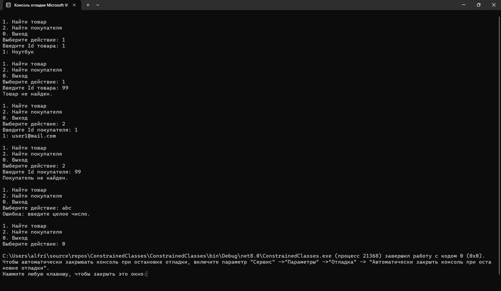

# ConstrainedClasses
## Задание «Контрольная точка №24 — ограниченные классы»
# Вариант 1. Репозиторий сущностей
1. Базовый класс Entity со свойством int Id { get; init; }.
2. Обобщённый класс Repository<T> where T : Entity с методами Add(T item) и T? GetById(int id).
3. Производные классы Product : Entity (с дополнительным свойством Name) и Customer : Entity (с дополнительным свойством Email).
4. Создайте Repository<Product> и Repository<Customer>, добавьте в каждый минимум два элемента.
5. Продемонстрируйте GetById для обоих репозиториев, включая случай, когда элемент с таким Id не найден.

# Результаты и проверочные ключи

## Скриншот резултата 

